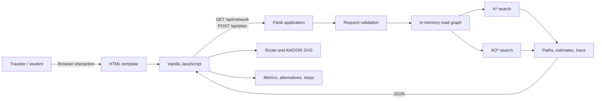
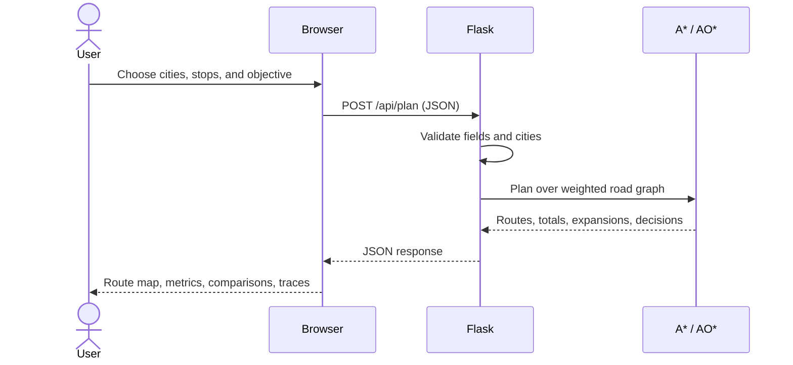

# Intelligent Travel Planner — Wayfinder AI

> **A B.Tech CSE Artificial Intelligence project demonstrating A\* and AO\* search for South Indian road-trip planning.**

**Wayfinder AI** is a locally runnable Flask web application. Choose a starting city, destination, optional ordered stops, and a travel objective; the application calculates and visualizes routes using a predefined, weighted road graph.

| Python | Framework | UI | Tests | License |
|---|---|---|---|---|
| 3.10+ | Flask 3.x | HTML, CSS, vanilla JavaScript | `unittest` | Not specified |

> This is an educational demonstration, not a live navigation service. Distances, speeds, and costs are illustrative estimates.

---

## Table of contents

1. [Project overview](#1-project-overview)
2. [Problem statement](#2-problem-statement)
3. [Vision and objectives](#3-vision-and-objectives)
4. [Key features](#4-key-features)
5. [Target users](#5-target-users)
6. [Use cases](#6-use-cases)
7. [Business and educational value](#7-business-and-educational-value)
8. [Screenshots](#8-screenshots)
9. [System architecture](#9-system-architecture)
10. [Application workflow](#10-application-workflow)
11. [Technology stack](#11-technology-stack)
12. [Project structure](#12-project-structure)
13. [Frontend architecture](#13-frontend-architecture)
14. [Backend architecture](#14-backend-architecture)
15. [Data and storage](#15-data-and-storage)
16. [API reference](#16-api-reference)
17. [Authentication and authorization](#17-authentication-and-authorization)
18. [AI search components](#18-ai-search-components)
19. [Prerequisites](#19-prerequisites)
20. [Installation](#20-installation)
21. [Environment variables](#21-environment-variables)
22. [Configuration](#22-configuration)
23. [Run in development](#23-run-in-development)
24. [Run in production](#24-run-in-production)
25. [Build process](#25-build-process)
26. [Deployment](#26-deployment)
27. [CI/CD](#27-cicd)
28. [Testing](#28-testing)
29. [Debugging](#29-debugging)
30. [Logging and monitoring](#30-logging-and-monitoring)
31. [Security considerations](#31-security-considerations)
32. [Performance](#32-performance)
33. [Coding conventions](#33-coding-conventions)
34. [Versioning](#34-versioning)
35. [Branching](#35-branching)
36. [Contributing](#36-contributing)
37. [Releases](#37-releases)
38. [Known limitations](#38-known-limitations)
39. [Future roadmap](#39-future-roadmap)
40. [FAQ](#40-faq)
41. [Troubleshooting](#41-troubleshooting)
42. [Changelog](#42-changelog)
43. [License](#43-license)
44. [Credits and acknowledgements](#44-credits-and-acknowledgements)
45. [Contact](#45-contact)
46. [Project summary](#46-project-summary)

---

## 1. Project overview

Travel planning across a network of connected cities is a path-search problem: multiple roads can reach a destination, and the best route depends on whether the traveler prioritizes distance, estimated cost, or time. Wayfinder AI makes that decision process visible rather than presenting a route as an unexplained answer.

The application models **10 South Indian cities and 27 undirected road connections**. A Python backend calculates routes with A\* and AO\*. A responsive browser interface lets users select cities and optional stops, inspect estimates, compare alternatives, and review search decisions. No database, paid API, map account, or API key is required.

**Project status:** functional local educational demo. Production hosting, live traffic data, user accounts, persistent trips, CI, and a published license are not configured.

## 2. Problem statement

Given a weighted road network, a starting city, a destination, and optionally required intermediate stops, determine a valid route that minimizes a selected measure. The project also demonstrates how two informed search approaches reason about the same planning problem and exposes their decisions in an understandable interface.

## 3. Vision and objectives

The goal is to make foundational AI search algorithms approachable through a usable travel-planning example.

- Represent cities as graph nodes and roads as weighted edges.
- Implement A\* and AO\* in Python against the actual sample graph.
- Support distance, estimated cost, and estimated duration objectives.
- Honor ordered optional stops.
- Return route alternatives and metrics derived from road-edge data.
- Visualize routes, A\* expansions, and AO\* decisions in a responsive dashboard.
- Keep the project straightforward to install and demonstrate locally.

## 4. Key features

- Dark, responsive dashboard with route-planning and algorithm-documentation sections.
- Start and destination selectors, city swapping, and up to three ordered optional stops in the UI.
- Three search objectives: shortest distance, lowest sample cost, and fastest estimated duration.
- A\* route recommendation with explored nodes and per-node `g`, `h`, and `f` values.
- AO\* solution over OR city states and AND road/continuation choices, with ordered stops represented as required trip legs.
- Up to three alternative paths, generated by blocking selected-route edges and rerunning A\*.
- Local SVG network and AND/OR graph visualizations; no external map provider is used.
- Reset, route comparison, expandable search steps, input validation, and error messages.
- Project notes and an A\*/AO\* comparison embedded in the dashboard.

## 5. Target users

- Students demonstrating AI search concepts in a B.Tech project.
- Instructors reviewing graph-search behavior and algorithm traces.
- Developers learning how a Flask JSON API can support a small interactive frontend.
- Travelers exploring the sample network as an educational demonstration—not for real-world navigation.

## 6. Use cases

1. Pick two cities and find a route optimized for distance, cost, or duration.
2. Require one or more intermediate stops in a specified order.
3. Compare the A\* result with alternative paths.
4. Inspect the A\* expansion order and heuristic values.
5. Inspect the AO\* solution and its decisions for the required journey legs.
6. Review a concise explanation of both algorithms and the application design.

## 7. Business and educational value

The project offers a low-friction, no-key demonstration that connects familiar travel choices to graph search. It provides explainable results, multiple objective functions, and observable algorithm traces in one small application. It has **no commercial booking, fare, traffic, or route-data integrations**, and does not claim production navigation accuracy.

## 8. Screenshots

No screenshots are committed in the repository. Run the application and open the dashboard to see the current UI. The route and algorithm visualizations are generated in the browser from the local API response.

## 9. System architecture

### High-level architecture



### Responsibilities and boundaries

| Layer | Responsibility |
|---|---|
| Browser template | Provides the dashboard, selectors, forms, navigation, and documentation content. |
| CSS and JavaScript | Responsive presentation, form state, same-origin API requests, safe text rendering, route alternatives, and local SVG diagrams. |
| Flask routes | Serves the page and network data, validates planning requests, invokes the algorithms, and returns JSON results. |
| Search and graph data | Stores the sample graph in Python and computes routes, totals, and decision traces. |
| Persistent storage | None. The graph and request data are held in memory; trips are not saved. |

### End-to-end user flow



## 10. Application workflow

The browser loads the dashboard and requests the city/road network for visualization. On submission, it posts the selected endpoints, ordered stops, and objective to Flask. Flask validates the JSON request and city names, runs A\*, generates alternatives, and runs AO\*. The browser renders the returned estimates and explanations.

All travel metrics are computed from the same road-edge data:

- **Distance:** sample kilometers assigned to each road.
- **Duration:** sample road distance divided by the road's assumed average speed, then summed.
- **Cost:** sample distance multiplied by an assumed INR-per-kilometer rate, then summed.

These are not live traffic, fuel, toll, or fare estimates.

## 11. Technology stack

| Area | Technology | Use |
|---|---|---|
| Runtime | Python 3.10 or later | Backend and search algorithms. |
| Web framework | Flask 3.x | Page serving and JSON endpoints. |
| Markup | HTML5 with Jinja template rendering | Dashboard structure and city selectors. |
| Styling | CSS3 | Responsive dark dashboard and visualizations. |
| Browser behavior | Vanilla JavaScript | Form interactions, API calls, and SVG rendering. |
| Test framework | Python `unittest` | Algorithm and API tests. |
| Data structure | In-memory Python dictionaries/lists | Sample graph and edge attributes. |
| Optional remote asset | Google Fonts | Enhanced typography; system font fallbacks remain available. |

There is no JavaScript package manager, frontend build tool, database, external mapping SDK, or required third-party API.

## 12. Project structure

```text
intelligent-travel--ai/
├── app.py                     # Flask routes, graph, A*, AO*, and planning helpers
├── requirements.txt           # Python runtime dependency
├── README.md                  # Project setup and technical guide
├── .gitignore                 # Virtual environments and Python cache exclusions
├── templates/
│   └── index.html             # Server-rendered dashboard
├── static/
│   ├── css/
│   │   └── style.css          # Theme, layout, responsive rules, SVG styles
│   └── js/
│       └── app.js             # Browser interactions and API result rendering
└── tests/
    └── test_algorithms.py     # A*, AO*, waypoint, alternative, and API tests
```

### Important files

- **`app.py`** — The application entry point. Defines the 10-city, 27-road graph; coordinate heuristic; A\*; AO\*; alternative-route generation; request validation; and `/`, `/api/network`, and `/api/plan`.
- **`templates/index.html`** — Jinja-rendered dashboard with city choices, route form, result containers, algorithm comparison, and project notes.
- **`static/js/app.js`** — Maintains client-side stop selections, calls the Flask API, handles errors, formats metrics, and draws local SVG route and AND/OR diagrams.
- **`static/css/style.css`** — Contains the visual theme, cards, layout, animations/transitions, and mobile breakpoints.
- **`tests/test_algorithms.py`** — Exercises route validity, ordered stops, alternate routes, all three objectives, AO\* results, and Flask API validation.
- **`requirements.txt`** — Declares Flask as the only required package.
- **`.gitignore`** — Excludes Python bytecode/cache directories and the local virtual environment.
- **`README.md`** — This documentation.

Generated `__pycache__` directories are runtime artifacts and are intentionally excluded from source control.

## 13. Frontend architecture

The frontend is a single Jinja page with static CSS and JavaScript. Flask supplies the city names while rendering the page. The JavaScript loads graph coordinates and connections from `/api/network`, submits plans to `/api/plan`, and builds the local SVG visualizations. It does not use a client-side framework or separate state-management library; form fields and a small in-memory stop list are the UI state.

User-provided route names inserted into dynamic markup are HTML-escaped. The page uses Google Fonts when reachable, with local CSS font fallbacks. External maps are not embedded.

## 14. Backend architecture

`app.py` currently groups application setup, sample data, search logic, validation, and HTTP handlers in one module:

1. **Graph initialization** creates an adjacency list from the undirected road table.
2. **A\*** searches states containing city, waypoint progress, and visited cities.
3. **Alternative generation** blocks each edge of the first route in turn and reruns A\* to find distinct candidates.
4. **AO\*** expands OR city states and backs up the cost of each AND choice (a road edge plus its continuation). Ordered waypoints must all be satisfied.
5. **Flask routes** expose HTML and JSON responses and return validation failures as HTTP 400 JSON.

The graph has no separate repository, service, or persistence layer; these would be reasonable future refactoring points if the application grows.

## 15. Data and storage

### Database architecture

There is **no database**. City coordinates, road links, speeds, and cost rates are constants in `app.py`. The application has no schema, migrations, database credentials, or persistent user data.

### Storage strategy

Graph data is loaded into process memory at startup. Plans and browser-side selection state exist only for the current request/page session. Restarting the process resets in-memory state; there are no saved trips or accounts.

### Sample network

Cities include Madanapalle, Tirupati, Bengaluru, Chennai, Hyderabad, Vijayawada, Kochi, Munnar, Mysuru, and Coimbatore. Each road is undirected and has a sample distance, average speed, and per-kilometer cost rate.

## 16. API reference

The API is same-origin and does not require credentials.

### `GET /api/network`

Returns the data needed by the local SVG renderer.

```json
{
  "cities": [{"name": "Madanapalle", "lat": 13.55, "lon": 78.5}],
  "roads": [{"from": "Madanapalle", "to": "Tirupati", "distance": 110}]
}
```

The example is abbreviated; the actual response includes every configured city and road. Speeds, costs, and duration are not included in this endpoint.

### `POST /api/plan`

Request JSON:

| Field | Type | Required | Meaning |
|---|---|---:|---|
| `start` | string | Yes | City name from the configured network. |
| `destination` | string | Yes | City name from the configured network. |
| `waypoints` | array of strings | No | Ordered intermediate cities; defaults to an empty list. |
| `preference` | string | No | `distance`, `cost`, or `time`; defaults to `distance`. |

Example request:

```json
{
  "start": "Madanapalle",
  "destination": "Kochi",
  "waypoints": ["Tirupati"],
  "preference": "distance"
}
```

Successful responses contain:

| Response key | Contents |
|---|---|
| `astar` | Recommended path, explored nodes, per-expansion `g`/`h`/`f` values, and distance/duration/cost totals. |
| `alternatives` | Up to three distinct A\*-generated candidate paths and their totals. |
| `ao` | AO\* path, totals, decision steps, and selected segments for required legs. |
| `preference` | Objective used by the search. |

Invalid JSON shapes, unknown cities, invalid preferences, duplicate stops, or a start equal to the destination without stops return HTTP `400` with an `error` message. A disconnected valid request also returns a route error.

## 17. Authentication and authorization

Authentication and authorization are **not implemented**. There are no users, roles, login flows, sessions, or protected data. The application is intended for local use and demonstration.

## 18. AI search components

### A\* route search

The A\* evaluation is:

```text
f(n) = g(n) + h(n)
```

- `g(n)` is the accumulated distance, sample cost, or estimated duration.
- `h(n)` estimates remaining cost using great-circle distance between the current city and the next required stop, plus distances between remaining stops.
- The estimate is scaled conservatively for the selected objective: distance uses kilometers, cost uses a sample lower-bound rate, and time uses a conservative hours-per-kilometer conversion.
- The priority queue expands the lowest estimated-total-cost state. Waypoint progress and visited cities are part of the state so that stops are honored in order and returned paths do not loop through cities.
- The search reconstructs the route from predecessor states and sums edge attributes to return all three metrics.

### AO\* route search

AO\* models this route problem as an AND-OR search graph:

- A city/waypoint/visited-set state is an **OR state**: choose one outgoing road continuation.
- A road continuation is an **AND choice**: include the road edge and solve its child state.
- The cost of an AND choice is the edge cost plus the child's backed-up value.
- The state chooses the least-cost estimated option. The algorithm expands the best partial solution, backs costs up through the graph, and stops when the selected solution is solved.
- A journey with intermediate stops requires all ordered legs; the selected leg results form the overall route.

The UI reports the selected solution and explanation steps. AO\* and A\* use the same graph and objective so their optimal costs can be compared.

### Alternative paths

The planner first computes the A\* recommendation. For each road edge in that path, it tries another A\* run with that edge excluded, deduplicates results, and returns at most three paths sorted by the selected objective (then distance). This provides useful alternatives without claiming to enumerate every possible simple path.

## 19. Prerequisites

- Python **3.10 or newer** (`app.py` uses modern type annotations).
- `pip`.
- A terminal and a browser.
- Git only if cloning or contributing.

No Node.js, database server, API key, or external map service is required.

## 20. Installation

From the project directory:

```powershell
py -m venv .venv
.\.venv\Scripts\Activate.ps1
py -m pip install -r requirements.txt
```

On macOS or Linux, activate the virtual environment with:

```bash
python3 -m venv .venv
source .venv/bin/activate
python -m pip install -r requirements.txt
```

The only declared runtime dependency is Flask (`Flask>=3.0,<4.0`).

## 21. Environment variables

No environment variables or `.env` file are currently required. There is no secrets file in the project. Flask's development server uses its built-in defaults when started with `py app.py`.

Do not set `FLASK_DEBUG=1` or expose a debug server on an untrusted network.

## 22. Configuration

There is no separate configuration module. To change the demonstration network or heuristic settings, edit the city/road data, `METRICS`, or `HEURISTIC_SCALE` in `app.py`. Keep edge weights non-negative and ensure each road endpoint exists in `CITIES`.

The UI's optional-stop control permits up to three stops. The backend validates the stop types, uniqueness, and city membership but does not independently enforce that three-stop UI limit.

## 23. Run in development

```powershell
py app.py
```

Open [http://127.0.0.1:5000](http://127.0.0.1:5000). Stop the development server with `Ctrl+C`.

Run the test suite in another terminal:

```powershell
py -m unittest discover -s tests -v
```

## 24. Run in production

`py app.py` starts Flask's built-in development server with debug mode enabled. **Do not use it as a production server or expose it publicly.**

The repository does not include a production WSGI server. For a basic production-style local run, install Waitress separately and run:

```powershell
py -m pip install waitress
waitress-serve --host=127.0.0.1 --port=8000 app:app
```

For a real deployment, use a supported WSGI host and configure the platform's process manager, HTTPS termination, network restrictions, and operational logging. Production hosting has not been configured or verified for this repository.

## 25. Build process

There is no compile or frontend build step. Flask serves the Jinja template and static assets directly. Python syntax can be checked with:

```powershell
py -m py_compile app.py tests\test_algorithms.py
```

## 26. Deployment

No Dockerfile, cloud deployment manifest, reverse-proxy configuration, domain, or deployment automation is included. The app can be deployed to any compatible Python host that supports a WSGI application, but production security and runtime configuration must be supplied by the deployer. Validate a production setup independently before making the service public.

## 27. CI/CD

No CI/CD workflow or build-status check is configured. Tests currently run locally with `unittest`. A future pipeline can install `requirements.txt`, run `py -m unittest discover -s tests -v`, and perform a Python syntax check.

## 28. Testing

Tests live in `tests/test_algorithms.py` and use the Python standard-library `unittest` runner.

The suite covers:

- A\* routes use real graph edges and return totals.
- Required waypoints are visited in order.
- Alternative routes are distinct and avoid repeated cities.
- Distance, cost, and time searches produce valid results.
- AO\* honors stops, returns a non-repeating route, and matches A\*'s selected-objective cost on test trips.
- Flask planning responses and invalid input handling.

Run all tests:

```powershell
py -m unittest discover -s tests -v
```

The current tests are local unit/API tests; there is no separate browser automation or load-test suite committed.

## 29. Debugging

- Start the app in a terminal to see Flask request logs and development tracebacks.
- Use `py -m py_compile app.py tests\test_algorithms.py` for syntax errors.
- Use `py -m unittest discover -s tests -v` to isolate algorithm or API regressions.
- Inspect `/api/network` in a browser to confirm that the configured graph is being served.
- Inspect the browser developer console and Network panel if the dashboard does not update.
- Confirm that both selected cities and every stop exist in `CITIES` when a request returns HTTP 400.

## 30. Logging and monitoring

The application currently relies on Flask's development request logging and standard Python exception reporting. There are no structured logs, metrics, tracing, error reporting integrations, health-check endpoint, or uptime monitoring.

## 31. Security considerations

- The application has no authentication, authorization, user profiles, or sensitive persistent data.
- Keep Flask's debug server and interactive debugger restricted to local development.
- Do not deploy the built-in server to the public internet.
- Use a production WSGI server, HTTPS, and platform-level access controls for any deployment.
- The API accepts JSON and validates city names, stop structure, and preference values.
- The page renders user-facing route values using text content or escaped strings.
- No CSRF token is implemented; the current app has no authenticated browser session or state-changing persistent operation.
- Sample route estimates are not authoritative driving directions or safety advice.

## 32. Performance

The sample graph is small, so searches execute synchronously within the Flask request and require no cache or background worker. Alternative generation runs A\* repeatedly, and AO\* explores its search graph; this is appropriate for the included network, not a performance guarantee for large real-world graphs. Larger networks would need profiling and likely improved graph storage, search limits, caching, or asynchronous computation.

## 33. Coding conventions

- Keep graph weights and city identifiers consistent across the data and tests.
- Preserve request validation and meaningful HTTP 400 error responses.
- Use the existing Python `unittest` framework unless a project change justifies another runner.
- Keep browser dependencies optional; the application has no JavaScript package manager.
- Add tests for changes to route validity, heuristics, waypoint handling, totals, or API shapes.
- Keep documentation accurate about whether a capability is implemented, estimated, or planned.

## 34. Versioning

No release version or formal versioning policy is currently declared. When public releases begin, semantic versioning (`MAJOR.MINOR.PATCH`) is a reasonable convention for this application.

## 35. Branching

No branch policy is currently configured. Contributors may use short-lived feature branches and submit pull requests, but this is a suggested workflow rather than an established project requirement.

## 36. Contributing

Contributions are welcome once the repository owner enables the desired collaboration workflow.

1. Create a branch for a focused change.
2. Keep changes scoped to the feature or fix.
3. Add or update tests for behavioral changes.
4. Run `py -m unittest discover -s tests -v`.
5. Update this README when setup, API behavior, or project capabilities change.
6. Submit a pull request describing the change and how it was verified.

Please avoid committing virtual environments, `__pycache__`, credentials, or generated local files. A formal code of conduct and pull-request template are not currently included.

## 37. Releases

There is no automated release process, package publication, or release history yet. A future release should include a reviewed test run, a Git tag, a concise changelog, and notes clarifying that route metrics are sample data.

## 38. Known limitations

- The road network contains only 10 sample cities and 27 sample connections.
- Distances, assumed speeds, and INR-per-kilometer rates are illustrative and may not reflect real routes, fares, tolls, traffic, or road conditions.
- No live maps, GPS, geocoding, traffic, transit, bookings, or external navigation service is connected.
- The route graphic is a schematic local SVG, not a geographically accurate road map.
- There is no database, account system, saved trip history, or administrator interface.
- The development entry point enables Flask debug mode; production requires a separate WSGI setup.
- CI/CD, deployment manifests, a published license, and formal release policies are absent.
- Alternative generation is bounded to reruns that exclude edges from the recommended route; it does not enumerate every possible route.

## 39. Future roadmap

These are potential improvements, not implemented features:

- Replace sample distances and rates with maintained, sourced data or opt-in provider integrations.
- Expand the road network and add configurable network import.
- Add a real map provider behind an optional integration with a local fallback.
- Persist saved trips and introduce authentication only if the product requires user accounts.
- Split graph, search, validation, and route services into dedicated modules as complexity grows.
- Add browser-level tests, continuous integration, deployment configuration, and production monitoring.
- Publish a license after the project owner selects one.

## 40. FAQ

### Do I need an API key?

No. Route calculation and the schematic SVG use local sample data. Google Fonts are optional.

### Is this a real navigation app?

No. It demonstrates algorithms. Use a trusted navigation service for actual travel.

### Why can A\* and AO\* show similar routes?

They plan against the same sample graph and objective. The dashboard compares their solution and decision process; the algorithms do not rely on different travel data.

### Are intermediate stops optional and ordered?

Yes. The browser allows up to three stops, and the route must visit them in the order selected before reaching the destination.

### Where are trips saved?

They are not saved. The application has no database or trip persistence.

### Can I run the application without internet access?

The Flask app and route calculations use local files and data. Google Fonts may not load offline, but system-font fallbacks are provided.

## 41. Troubleshooting

| Problem | Suggested action |
|---|---|
| `py` is not recognized | Install Python 3.10+ and enable the Windows Python launcher, or use `python` if available. |
| Flask import error | Activate the virtual environment and run `py -m pip install -r requirements.txt`. |
| Port 5000 is already in use | Stop the other local process or run the development app on a different port by changing `app.run(...)` locally. |
| HTTP 400 from `/api/plan` | Check that the request is a JSON object, the city names are configured, and the objective is `distance`, `cost`, or `time`. |
| Route not found | Check that the selected cities/stops are connected in the configured graph and that stops are in a valid order. |
| SVG map is missing | Confirm `/api/network` returns successfully and inspect browser console errors. |
| Fonts look different offline | This is expected; Google Fonts are optional and system fallbacks are used. |
| Production command fails | Waitress is optional and is not in `requirements.txt`; install it separately or configure another WSGI server. |

## 42. Changelog

No formal changelog has been maintained yet.

| Version | Date | Notes |
|---|---|---|
| Unreleased | — | Initial project documentation; see repository history for code changes. |

## 43. License

**No license is currently specified.** Until the project owner adds a license file and updates this section, do not assume that source-code redistribution or reuse is granted.

## 44. Credits and acknowledgements

- Built as an educational B.Tech CSE Artificial Intelligence project.
- Uses the Python Flask web framework.
- Uses classic A\* and AO\* search concepts.
- Google Fonts are an optional interface enhancement; the application does not depend on them for route planning.

## 45. Contact

For project questions or proposed changes, use the repository's GitHub Issues or Pull Requests:

**Repository:** [laharireddy1010/intelligent-travel--ai](https://github.com/laharireddy1010/intelligent-travel--ai)

No separate support email or project website is configured.

## 46. Project summary

Wayfinder AI is a local Flask travel-planning demonstration that models a small South Indian road network and uses A\* and AO\* to find explainable routes. It supports ordered stops and distance, sample-cost, and estimated-time objectives; presents alternatives and algorithm traces; and runs without a database or mandatory API key. Its figures are illustrative, and production navigation, hosting, identity, persistence, monitoring, and licensing remain outside the current implementation.
